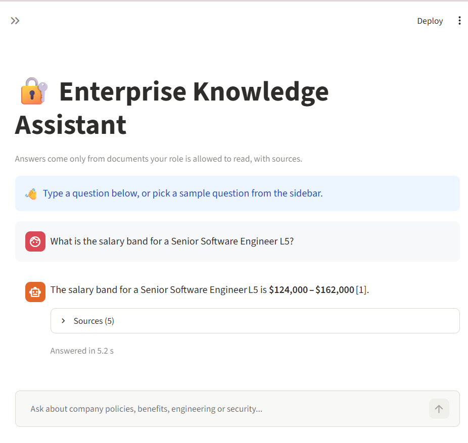
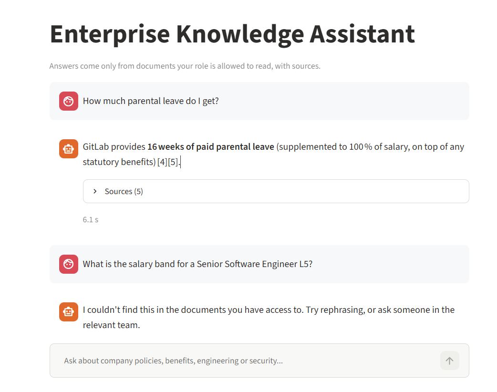
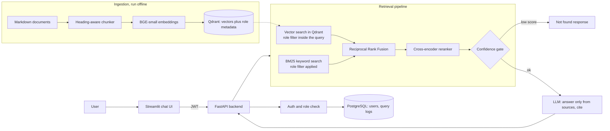

# Enterprise Knowledge Assistant

A secure RAG (retrieval-augmented generation) assistant. Employees ask questions in plain language and get **cited answers drawn only from the documents their role is allowed to read**.

The key design decision: **access control is enforced inside the vector search, before any text reaches the LLM.** A user who may not see salary data cannot receive it, because those chunks are never retrieved.

## Demo

| Same question: *"What is the salary band for a Senior Software Engineer L5?"* | Result |
|---|---|
| Logged in as `alice_employee` | Not found (document is finance-only) |
| Logged in as `dave_finance` | Answered with sources |




## Features

- **Hybrid retrieval**: vector search (BGE embeddings) plus BM25 keyword search, merged with Reciprocal Rank Fusion
- **Cross-encoder reranking** of the best candidates
- **Cited answers**: every claim points to a source document and section
- **"Not found" instead of guessing**: a calibrated confidence threshold stops the LLM being called when nothing relevant is retrieved
- **Role-based access control** across 7 roles, applied at retrieval time
- **JWT authentication** with salted password hashing; the role always comes from the verified token and the database, never from the request body
- **LLM provider fallback**: primary provider with automatic retry and a backup provider
- **Query logging** in PostgreSQL with an admin-only log endpoint
- **Automated tests** for access control and authentication

## Architecture



### Why each part exists

| Component | Why it is there |
|---|---|
| Heading-aware chunking | Keeps each chunk about one topic and preserves the section path for citations |
| Role metadata on every chunk | Lets Qdrant filter by permission *before* ranking |
| BM25 + vectors | Embeddings capture meaning; keywords catch exact terms such as policy names and codes |
| Reranker | First-pass search is fast but rough; the cross-encoder reads question and chunk together and picks the best |
| Confidence gate | Refuses off-topic questions without spending an LLM call or risking a hallucination |
| JWT + DB lookup | Identity is verified on every request; the client cannot claim a role |

## Data

- **453 pages of the public GitLab Handbook** across 5 departments (engineering, security, finance, HR, general). Attribution: GitLab; please check the handbook's licence terms before redistributing.
- **5 synthetic confidential documents** (salary bands, Q3 budget, performance plans, restructuring draft, vulnerability report). These are entirely fictional and exist only to demonstrate access control.
- Result: **11,442 chunks** in Qdrant.

| Department | Readable by |
|---|---|
| general | every role |
| hr | hr, manager, admin |
| engineering | engineer, admin |
| security | security, engineer, admin |
| finance | finance, admin |

## Evaluation

Retrieval was measured on a 49-question test set where each question has the correct source file(s), using the top 5 chunks:

| Method | Hit@5 | MRR@5 | Avg latency |
|---|---|---|---|
| Vector only | 93.9% | 0.856 | 43 ms |
| Hybrid (vector + BM25) | 95.9% | 0.819 | 47 ms |
| Hybrid + reranker | 95.9% | 0.893 | 1236 ms |

**How to read this:** the questions were written from page titles, so vector search already scores high and the test set is small (one question is about 2 points). The clearest gain is in ranking quality (MRR): the reranker puts the right page higher. Hybrid alone lowered MRR, because keyword hits sometimes pushed good vector results down; the reranker corrected that.

Reproduce with `python -m scripts.evaluate`.

**Access-control tests:** 19 automated tests check that, for all 7 roles in both search modes, no returned chunk is outside the role's permissions, that employees never see the confidential documents, and that the API rejects missing and invalid tokens.

## Tech stack

Python, FastAPI, Qdrant, PostgreSQL, Sentence-Transformers (`BAAI/bge-small-en-v1.5`), cross-encoder reranker (`ms-marco-MiniLM-L-6-v2`), rank-bm25, PyJWT, Streamlit, Docker Compose, pytest. LLM access through an OpenAI-compatible API (Groq primary, Gemini fallback).

## Setup

Requires Docker Desktop, Git and Python 3.10+.

```bash
git clone <this repo>
cd Enterprise_Knowledge_Assistant
python -m venv .venv
.venv\Scripts\activate            # macOS/Linux: source .venv/bin/activate
pip install -r requirements.txt
pip install sentence-transformers rank-bm25 openai fastapi uvicorn pyjwt streamlit requests pytest httpx
```

Create a `.env` file from `.env.example` and fill in your own values (never commit it): database password, `LLM_API_KEY` and `LLM_FALLBACK_API_KEY`, and a `JWT_SECRET` generated with
`python -c "import secrets; print(secrets.token_hex(32))"`.

```bash
docker compose up -d                       # Qdrant, PostgreSQL, Redis
python scripts/download_handbook.py        # fetch the handbook subset
python -m scripts.make_synthetic_docs      # fictional confidential documents
python -m scripts.ingest                   # chunk, embed, store
python -m scripts.seed_users               # one demo user per role
```

Run the app in two terminals:

```bash
uvicorn app.api.main:app --port 8000
streamlit run frontend/app.py
```

Open http://localhost:8501. Demo users: `alice_employee`, `gina_manager`, `carol_engineer`, `bob_hr`, `dave_finance`, `erin_security`, `frank_admin` (password set by `DEMO_PASSWORD` in `.env`). API docs are at http://127.0.0.1:8000/docs.

Run the tests with `python -m pytest tests -v`.

## Project structure

```
app/
  api/         FastAPI routes
  core/        configuration, JWT and password handling
  db/          PostgreSQL access
  ingestion/   Markdown parsing and chunking
  retrieval/   vector search, BM25, fusion, reranking
  generation/  prompt, LLM calls, confidence gate
frontend/      Streamlit chat UI
scripts/       ingestion, evaluation, calibration, seeding
eval/          test set
tests/         access-control and API tests
```

## Limitations and future work

- Each question is answered independently: there is no query rewriting, so follow-ups such as "what about contractors?" do not work yet.
- The reranker ranks some country-specific pages above the company-wide policy for general questions, which can blend details from different regions in an answer.
- The test set is small and title-derived; a larger set with paraphrased questions would give a more reliable comparison.
- Documents are ingested by script; there is no upload UI or admin dashboard.
- Redis is provisioned in Docker Compose for caching but is not used yet.
- No rate limiting on login, and the app has not been deployed to a cloud host.
- Scanned PDFs, tables and images are out of scope (no OCR or layout analysis), a deliberate trade-off for time and compute.
- The free LLM tiers can be rate limited or overloaded, which is why a fallback provider is configured.
